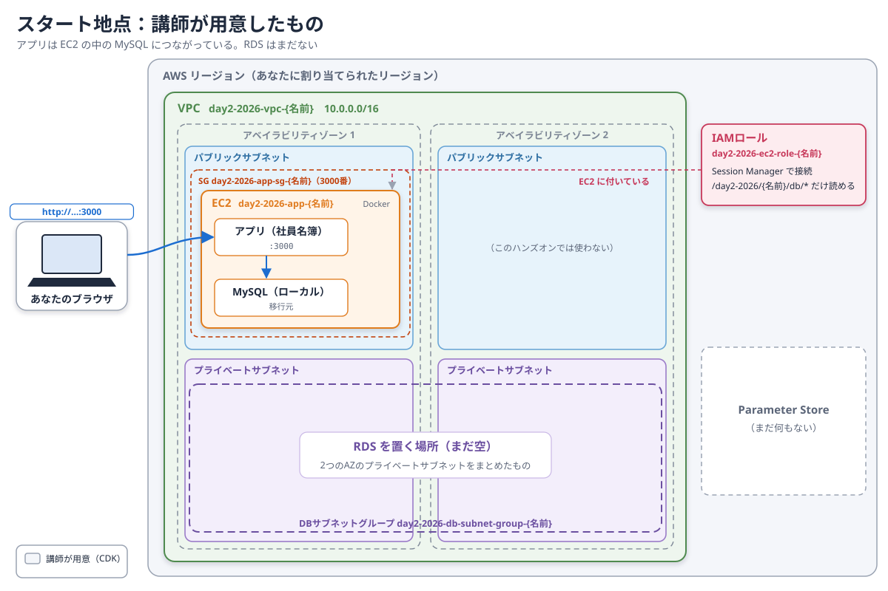
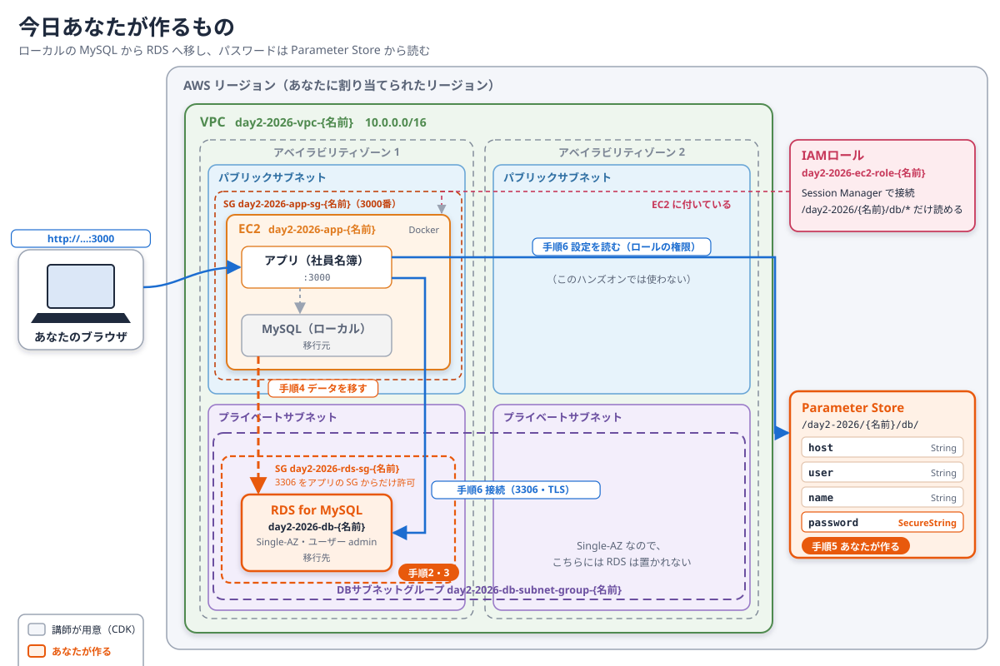

# Day 2: データベースを RDS へ移す（RDS と Parameter Store）

## 目標

EC2の中で動いているMySQLのデータを、Amazon RDSへ移します。アプリケーションの接続先をRDSへ切り替え、パスワードはAWS Systems ManagerのParameter Storeから読ませます。

- 止める・コピーする・確かめる・切り替える、の順で移行する。
- アプリケーションにパスワードを書かず、EC2のロールの権限でParameter Storeから読ませる。
- 切り戻すと何が起きるかを、画面で確かめる。

ここで扱う考え方は、事前学習の3章（RDSにつながるための3つの条件）、6章（移行の進め方）、7章（DBユーザーと接続情報）、8章（成功の判定と切戻し）で説明しています。

## 構成

まず、スタート地点を確かめます。講師が、あなた専用のVPCとEC2を用意しています。EC2の中では、アプリケーション（社員名簿）とMySQLがコンテナで動いています。



今日あなたが作るのは、オレンジの部分です。図の「手順2」などの番号は、このページの手順の番号と同じです。



## 重要: リソース名の命名規則

共有のAWSアカウントを使うため、**すべてのリソース名に `{あなたの名前}` を付けてください。** 自分の名前が付いたリソース以外は、変更・削除しないでください。

## 講師から配られる値（例）

| 項目 | 例 |
| --- | --- |
| 自分のリージョン | `us-west-2` |
| 自分の名前（リソース名に付ける） | `tanaka` |

手順の中の `{あなたの名前}` は、配られた値に置き換えてください。作業はすべて、コンソール右上で自分のリージョンを選んだ状態で行います。

講師が用意したリソースは、次のとおりです。

| リソース | 名前 |
| --- | --- |
| VPC | `day2-2026-vpc-{あなたの名前}` |
| EC2 | `day2-2026-app-{あなたの名前}` |
| アプリケーションのセキュリティグループ | `day2-2026-app-sg-{あなたの名前}` |
| DBサブネットグループ | `day2-2026-db-subnet-group-{あなたの名前}` |
| EC2のIAMロール | `day2-2026-ec2-role-{あなたの名前}` |

---

## 手順1：アプリケーションを確かめる

1. **EC2** を開き、`day2-2026-app-{あなたの名前}` を選ぶ。「パブリック IPv4 アドレス」を確かめる。
2. ブラウザで `http://{パブリックIPv4アドレス}:3000` を開く。
3. 画面上部の「接続先」に **ローカル MySQL（EC2内のコンテナ）** と表示され、社員一覧が出ることを確かめる。
4. 「新規従業員登録」で、次の社員を1件登録する。

   | 項目 | 入力する値 |
   | --- | --- |
   | 従業員ID | `L-{あなたの名前}` |
   | 部署 | 好きな部署 |
   | 姓・名 | 好きな名前 |
   | メールアドレス | `l-{あなたの名前}@example.com` |

この `L-{あなたの名前}` は、移行前のDBに入れた目印です。あとで、RDSにも移っていることを確かめます。

## 手順2：RDS用のセキュリティグループを作る

RDSへの通信を、アプリケーションのEC2からだけ許可します（事前学習3章）。

1. **EC2** の左メニュー「セキュリティグループ」→「セキュリティグループを作成」を選ぶ。
2. 次のとおり設定する。

   | 項目 | 設定 |
   | --- | --- |
   | セキュリティグループ名 | `day2-2026-rds-sg-{あなたの名前}` |
   | 説明 | `MySQL from app` |
   | VPC | `day2-2026-vpc-{あなたの名前}` |
   | インバウンドルール | 「ルールを追加」。タイプ「MYSQL/Aurora」（ポート3306）、ソース「カスタム」で `day2-2026-app-sg-{あなたの名前}` を選ぶ |
   | アウトバウンドルール | 既定のまま |

3. 「セキュリティグループを作成」を選ぶ。

ソースにIPアドレスではなくセキュリティグループを指定すると、「そのセキュリティグループが付いたもの（ここではアプリケーションのEC2）から」という意味になります。

## 手順3：RDSを作る

1. **Aurora and RDS** を開き、「データベースの作成」を選ぶ。
2. 次のとおり設定する。書いていない項目は既定値のままでよい。

   | 項目 | 設定 |
   | --- | --- |
   | データベース作成方法 | 標準作成 |
   | エンジンのタイプ | MySQL |
   | エンジンバージョン | MySQL 8.4 の最新 |
   | テンプレート | 無料利用枠。表示されない場合は「開発/テスト」 |
   | 可用性と耐久性 | 単一AZ DBインスタンス |
   | DBインスタンス識別子 | `day2-2026-db-{あなたの名前}` |
   | マスターユーザー名 | `admin` |
   | 認証情報管理 | セルフマネージド |
   | マスターパスワード | 研修用パスワード `Tr41n-Rds2026-Kq7mZx` をコピーして貼り付ける。確認用の欄にも同じ値を貼り付ける（下の注意を参照） |
   | インスタンスの設定 | バースト可能クラス、`db.t3.micro` |
   | ストレージ | 汎用SSD（gp3）、20 GiB。「ストレージの自動スケーリング」はオフ |
   | コンピューティングリソース | EC2コンピューティングリソースに接続しない |
   | VPC | `day2-2026-vpc-{あなたの名前}` |
   | DBサブネットグループ | `day2-2026-db-subnet-group-{あなたの名前}` |
   | パブリックアクセス | なし |
   | VPCセキュリティグループ | 「既存の選択」。`default` を外し、`day2-2026-rds-sg-{あなたの名前}` だけにする |
   | モニタリング | 「拡張モニタリング」は無効 |
   | 追加設定 → バックアップ | 自動バックアップを有効、保持期間は1日 |
   | 追加設定 → 削除保護 | 無効 |

3. 「データベースの作成」を選ぶ。

マスターパスワードは、入力の間違いを防ぐため、研修用に決めた次の値をコピーして使います。手順4と手順5でも同じ値を使います。

```text
Tr41n-Rds2026-Kq7mZx
```

**この値は研修用で、この手順書と一緒に公開されています。実際の業務では、このような公開された値は使いません。** 自分だけが知る、推測されにくいパスワードを使います。

「拡張モニタリング」を有効にすると、OSレベルの細かい指標を集めるため、RDSがモニタリング用のIAMロールを作ります。このハンズオンでは使わないので、無効にします。

作成には時間がかかります。データベースの一覧で、`day2-2026-db-{あなたの名前}` の「ステータス」が「利用可能」になるまで待ちます。待つ間に、次のことを確かめてください。

### 待つ間に：EC2のロールが読めるパラメータを確かめる

1. **IAM** の「ロール」で `day2-2026-ec2-role-{あなたの名前}` を開き、「許可」タブを見る。
2. インラインポリシー `day2-2026-read-my-params` の左にある展開ボタン（⊞）を選び、JSONを読む。

| Sid | Effect | 意味 |
| --- | --- | --- |
| `ReadMyDbParams` | `Allow` | `/day2-2026/{あなたの名前}/db/` の下のパラメータを読める |
| `DenyOtherParams` | `Deny` | それ以外のパラメータは、読もうとしても拒否される |

同じロールに付いている `AmazonSSMManagedInstanceCore` は、Session Managerで接続するためのポリシーですが、すべてのパラメータを読む許可も含んでいます。そのため、`Deny` で自分のパラメータ以外を明示的に拒否しています。Day 1で学んだとおり、明示的な拒否は許可より優先されます。

## 手順4：データを移す

事前学習6章の順に、**止める・コピーする・確かめる** を行います。

### 4-1. EC2に接続する

1. **EC2** で `day2-2026-app-{あなたの名前}` を選び、「接続」を選ぶ。「ウェブブラウザで」タブで「SSM セッションマネージャー」を選び、「接続」を押す。
2. 開いたターミナルで、`ubuntu` ユーザーに切り替え、アプリケーションのディレクトリへ移動する。以降のコマンドは、すべてこのディレクトリで実行する。

   ```bash
   sudo su - ubuntu
   cd ~/strong-system-dot-com/docs/2026/day2/app
   docker compose ps
   ```

   `app` と `db` の2つが `running` になっていることを確かめます。

### 4-2. アプリケーションを止める

ダンプの後に書き込まれたデータは、RDSへ届きません。先にアプリケーションを止めます（事前学習6.2）。

```bash
docker compose stop app
```

ブラウザでアプリケーションを再読み込みすると、表示されなくなります。MySQL（`db`）は動いたままです。

### 4-3. 移行前の件数を記録する

```bash
docker compose exec db mysql -uroot -ppassword --default-character-set=utf8mb4 -e "SELECT COUNT(*) FROM employee_db.employees; SELECT employee_id, last_name, first_name FROM employee_db.employees WHERE employee_id LIKE 'L-%';"
```

`COUNT(*)` の数と、`L-{あなたの名前}` の行をメモしておきます。これはEC2の中のMySQLの、研修用のパスワードです。

### 4-4. ダンプを取る

```bash
docker compose exec -T db mysqldump -uroot -ppassword --single-transaction --no-tablespaces --databases employee_db > employee_db.sql
head -n 20 employee_db.sql
```

`employee_db.sql` には、テーブルを作る `CREATE TABLE` と、データを入れる `INSERT` が書かれています。

### 4-5. RDSへ読み込む

1. **Aurora and RDS** で `day2-2026-db-{あなたの名前}` を開き、「接続とセキュリティ」タブの「エンドポイント」をコピーする。
2. EC2のターミナルで、エンドポイントを変数に入れる。`{エンドポイント}` は、コピーした値に置き換える。

   ```bash
   RDS_HOST='{エンドポイント}'
   ```

3. ダンプをMySQLコンテナへコピーし、コンテナの中の `mysql` コマンドでRDSへ読み込む。

   ```bash
   docker compose cp employee_db.sql db:/tmp/employee_db.sql
   docker compose exec db mysql -h "$RDS_HOST" -u admin -p --ssl-mode=REQUIRED --default-character-set=utf8mb4 -e "source /tmp/employee_db.sql"
   ```

   `Enter password:` と表示されたら、手順3の研修用パスワードを貼り付けて Enter を押します。貼り付けた文字は表示されません。

パスワードをコマンドに書かず、入力を求めさせています。コマンドに書くと、コマンドの履歴に残るためです。`--ssl-mode=REQUIRED` は、RDSとの通信をTLSで暗号化する指定です。`--default-character-set=utf8mb4` は、日本語を正しく扱うための指定です。

### 4-6. 移行後の件数を確かめる

```bash
docker compose exec db mysql -h "$RDS_HOST" -u admin -p --ssl-mode=REQUIRED --default-character-set=utf8mb4 -e "SELECT COUNT(*) FROM employee_db.employees; SELECT employee_id, last_name, first_name FROM employee_db.employees WHERE employee_id LIKE 'L-%';"
```

**期待結果：4-3でメモした件数と `L-{あなたの名前}` の行が、RDSでも同じ。** これで、データがRDSへコピーされたことが確かめられました（事前学習8.1の1つ目）。

## 手順5：接続情報をParameter Storeに保存する

アプリケーションがRDSへ接続するための情報を、Parameter Storeに置きます（事前学習7.2）。

1. **Systems Manager** を開き、左メニュー「パラメータストア」→「パラメータの作成」を選ぶ。
2. 次の4つを、1つずつ作成する。利用枠は「標準」のまま。

   | 名前 | 種類 | 値 |
   | --- | --- | --- |
   | `/day2-2026/{あなたの名前}/db/host` | 文字列（String） | RDSのエンドポイント |
   | `/day2-2026/{あなたの名前}/db/user` | 文字列（String） | `admin` |
   | `/day2-2026/{あなたの名前}/db/name` | 文字列（String） | `employee_db` |
   | `/day2-2026/{あなたの名前}/db/password` | 安全な文字列（SecureString） | 手順3の研修用パスワード |

   `password` の「KMSキーソース」は「現在のアカウント」、「KMSキーID」は `alias/aws/ssm` のままにします。

3. 作成した `password` を開き、値が `****` のように隠れていることを確かめる。「表示」を選ぶと、復号した値が見えます。

名前の先頭の `/day2-2026/{あなたの名前}/db/` は、待つ間に確かめたロールの `Allow` と同じです。ここ以外に作ると、アプリケーションは読めません。

本来、アプリケーションにはマスターユーザーを渡さず、アプリケーション専用のDBユーザーを作って渡します（事前学習7.1）。このハンズオンでは手順を短くするため、マスターユーザー `admin` をそのまま使います。

## 手順6：アプリケーションの接続先を切り替える

1. EC2のターミナルで、設定ファイル `.env` の `DB_SOURCE` を `ssm` に変える。

   ```bash
   sed -i 's/^DB_SOURCE=.*/DB_SOURCE=ssm/' .env
   cat .env
   ```

   `DB_SOURCE=ssm` になっていることを確かめます。`PARAM_PREFIX` は、手順5で作ったパラメータの場所です。

2. アプリケーションを起動し直す。

   ```bash
   docker compose up -d
   ```

   アプリケーションは、起動するときにParameter Storeから接続情報を読みます。設定を変えたら、起動し直す必要があります。

3. ブラウザでアプリケーションを再読み込みする。

**期待結果：「接続先」が水色の Amazon RDS に変わり、その下にRDSのエンドポイントが表示される。社員一覧に `L-{あなたの名前}` がある。**

続けて、RDSに新しいデータを書きます。

1. 「新規従業員登録」で、従業員ID `R-{あなたの名前}`、メールアドレス `r-{あなたの名前}@example.com` の社員を1件登録する。そのほかの項目は好きな値でよい。
2. 登録した `R-{あなたの名前}` を「編集」で変更し、保存する。
3. もとからいる社員を1人選び、「削除」する。

このとき、アプリケーションは次の2つを行っています（事前学習7.3）。

| 何をしているか | 何で認証するか |
| --- | --- |
| Parameter Storeから接続情報を読む | EC2のIAMロール |
| RDSのMySQLへログインする | DBユーザー名（`admin`）とパスワード |

アプリケーションのコードにも `.env` にも、パスワードは書かれていません。

## 手順7：切り戻すと何が起きるかを見る

接続先をローカルのMySQLへ戻してみます（事前学習8.2）。

1. EC2のターミナルで、`DB_SOURCE` を `local` に戻し、起動し直す。

   ```bash
   sed -i 's/^DB_SOURCE=.*/DB_SOURCE=local/' .env
   docker compose up -d
   ```

2. ブラウザで再読み込みする。

   **期待結果：「接続先」がローカル MySQL に戻る。`L-{あなたの名前}` はあるが、手順6で登録した `R-{あなたの名前}` はない。手順6で削除した社員は、まだいる。**

   切り替えた後にRDSへ書いたデータは、ローカルのMySQLにはありません。接続先を戻すだけでは、そのデータが見えなくなります。実際の移行で切り戻すときは、RDSに書かれたデータをどう扱うかを決めてから戻します。

3. 確かめたら、接続先をRDSへ戻す。

   ```bash
   sed -i 's/^DB_SOURCE=.*/DB_SOURCE=ssm/' .env
   docker compose up -d
   ```

   再読み込みすると、「接続先」が Amazon RDS になり、`R-{あなたの名前}` がまた表示されます。

## 後片付け

講師の指示に従って行います。

1. **Aurora and RDS** で `day2-2026-db-{あなたの名前}` を選び、「アクション」→「削除」を選ぶ。
   - 「最終スナップショットを作成」：オフ
   - 「自動バックアップを保持」：オフ
   - 確認のチェックを入れ、`delete me` と入力して「削除」
2. データベースの一覧から `day2-2026-db-{あなたの名前}` が消えるまで待つ。
3. **EC2** の「セキュリティグループ」で `day2-2026-rds-sg-{あなたの名前}` を削除する。RDSの削除が終わる前は、削除できません。
4. **Systems Manager** の「パラメータストア」で、`/day2-2026/{あなたの名前}/db/` の4つのパラメータを選び、削除する。
5. Session Managerのセッションを終了する。

VPC、EC2、DBサブネットグループ、IAMロールは講師が削除します。削除しないでください。

## 詰まった場合

| 状況 | 確認すること |
| --- | --- |
| アプリケーションの画面が開かない | `http://`（`https://` ではない）と `:3000` を付けたか。手順4-2で止めた後なら、表示されないのは想定どおり |
| RDSのVPCやサブネットグループが選べない | コンソール右上のリージョンが、自分のリージョンか |
| 4-5で接続できずに止まる、`Can't connect` | RDSの「ステータス」が「利用可能」か。RDSのセキュリティグループが `day2-2026-rds-sg-{あなたの名前}` だけか。そのインバウンドルールのソースが `day2-2026-app-sg-{あなたの名前}` か |
| 4-5で `Access denied` | ユーザー名が `admin` か。パスワードが、手順3の研修用パスワードか。前後に空白が入っていないか |
| 4-6で件数が違う | 4-2でアプリケーションを止めた後にダンプを取ったか |
| 切り替え後、「接続先」の下に「パラメータが見つかりません」 | パラメータの名前の先頭が `/day2-2026/{あなたの名前}/db/` か。4つすべて作ったか。作ったリージョンが自分のリージョンか |
| 切り替え後、`AccessDeniedException` | パラメータを作った場所が、ロールの `Allow` と同じ場所か |
| 切り替え後、`Access denied for user` | `/user` の値が `admin` か。`/password` の値が研修用パスワードで、前後に空白が入っていないか。直したら `docker compose up -d --force-recreate app` で起動し直す |
| 切り替え後、`ETIMEDOUT` | `/host` の値がRDSのエンドポイントか。RDSのセキュリティグループの設定 |
| 画面が古いまま | `.env` の `DB_SOURCE` を確かめ、`docker compose up -d` を実行したか |
