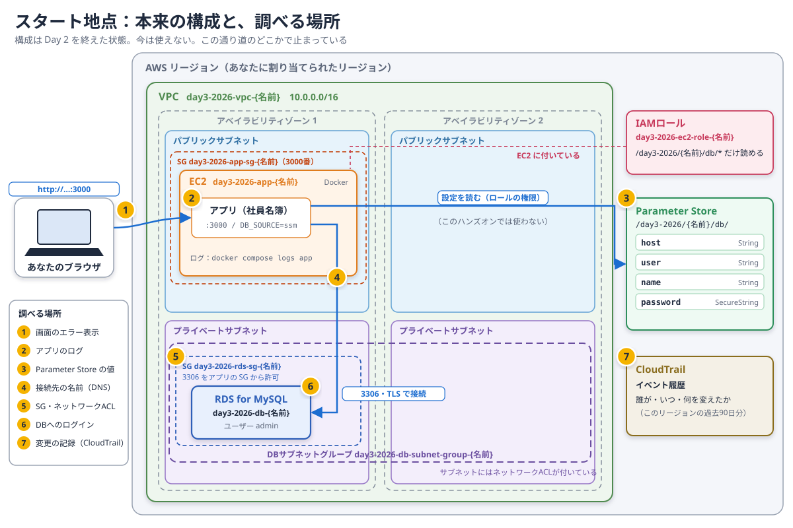

# Day 3: 障害の原因を切り分けて、復旧する

## 目標

使えなくなった社員名簿を、根拠を集めて原因を絞り込み、元どおりに使える状態へ戻します。

- 推測で設定を変えず、画面・ログ・変更の記録から原因の見当を付ける。
- 外側から順に、どこまで届いていて、どこで止まっているかを確かめる。
- 変更は小さく1つずつ行い、復旧は利用者の操作まで確かめる。

ここで扱う考え方は、事前学習の4章（外側から順に切り分ける）、5章（エラーメッセージで段階を見分ける）、6章（記録を見る）、7章（復旧）、8章（復旧の確認）で説明しています。

## 構成

講師が、あなた専用の環境を用意しています。構成は、Day 2 を終えた状態と同じです。アプリケーション（社員名簿）は、Parameter Store から接続情報を読み、RDS につながって動いていました。



今は使えません。この通り道のどこかで止まっています。図の①〜⑦は、このページの手順で調べる場所です。番号の順は、事前学習4章の「外側から順に」に合わせています。

## 重要: リソース名の命名規則

共有のAWSアカウントを使うため、**自分の名前が付いたリソース以外は、変更・削除しないでください。** このハンズオンでは、新しいリソースは作りません。

## 講師から配られる値（例）

| 項目 | 例 |
| --- | --- |
| 自分のリージョン | `us-west-2` |
| 自分の名前 | `tanaka` |

手順の中の `{あなたの名前}` は、配られた値に置き換えてください。作業はすべて、コンソール右上で自分のリージョンを選んだ状態で行います。

| リソース | 名前 |
| --- | --- |
| VPC | `day3-2026-vpc-{あなたの名前}` |
| EC2 | `day3-2026-app-{あなたの名前}` |
| アプリケーションのセキュリティグループ | `day3-2026-app-sg-{あなたの名前}` |
| RDS | `day3-2026-db-{あなたの名前}` |
| RDSのセキュリティグループ | `day3-2026-rds-sg-{あなたの名前}` |
| パラメータ | `/day3-2026/{あなたの名前}/db/host`、`/user`、`/name`、`/password` |
| EC2のIAMロール | `day3-2026-ec2-role-{あなたの名前}` |

## 状況

利用者から「社員名簿が使えない」と連絡がありました。昨日までは使えていました。

あなたは運用の担当者です。原因を見つけて、元どおり使える状態に戻してください。

## 進め方の約束

- **推測で設定を変えない。** 変える前に、なぜそこを変えるのかの根拠を確かめます。
- **変更は1つずつ。** 1つ変えたら、その結果を確かめてから次に進みます。
- **その場しのぎをしない。** 次のことはしません。
  - セキュリティグループで 3306 を `0.0.0.0/0` に開ける
  - IAMロールに `AdministratorAccess` などの強い権限を付ける
  - RDS を作り直す、スナップショットから戻す
- **手元にメモを取る。** 何を見て、何が分かったか。何を、いつ、どう変えたか。

---

## 手順1：影響を確かめる（①）

1. **EC2** を開き、`day3-2026-app-{あなたの名前}` の「パブリック IPv4 アドレス」を確かめる。
2. ブラウザで `http://{パブリックIPv4アドレス}:3000` を開く。
3. 画面上部の「接続先」と、その下に出ているメッセージを、そのままメモする。

画面が表示されるなら、アプリケーションは動いています。止まっているのは、その先です。

## 手順2：アプリケーションの状態とログを見る（②）

1. **EC2** で `day3-2026-app-{あなたの名前}` を選び、「接続」を選ぶ。「ウェブブラウザで」タブで「SSM セッションマネージャー」を選び、「接続」を押す。
2. `ubuntu` ユーザーに切り替え、アプリケーションのディレクトリへ移動する。以降のコマンドは、すべてこのディレクトリで実行する。

   ```bash
   sudo su - ubuntu
   cd ~/strong-system-dot-com/docs/2026/day2/app
   ```

3. アプリケーションのコンテナの状態と、ログを見る。

   ```bash
   docker compose ps
   docker compose logs --tail 30 app
   ```

ログの最初のほうに、起動したときに読んだ接続先が出ています（`DB_SOURCE=ssm host=... database=...`）。エラーが出ていれば、その時刻と内容をメモします。

設定ファイル `.env` の中身も確かめておきます。

```bash
cat .env
```

`PARAM_PREFIX` は、アプリケーションが接続情報を読む Parameter Store の場所です。

## 手順3：変更の記録を見る（⑦）

「昨日まで使えていた」なら、昨日から今日までに何が変わったかが、大きな手掛かりです（事前学習6.3）。

1. **CloudTrail** を開き、左メニューの「イベント履歴」を選ぶ。
2. 検索の条件で「読み取り専用」を選び、`false` を指定する。参照だけの操作が除かれ、何かを作成・変更・削除した操作だけになります。
3. 右上の時間の範囲を「1日」にする。
4. 一覧で、「イベント名」「イベント時間」「ユーザー名」「リソース名」を見る。

講師が環境を作ったときの操作（CloudFormation による作成など）も、たくさん並んでいます。環境ができた**後**に、誰かが何かを**変えた**記録を探します。気になるイベントは、選ぶと詳しい内容（何を、どの値に変えたか）を見られます。

見つけた変更は、時刻・ユーザー名・内容をメモします。ただし、まだ直しません。手順4で、その変更が本当に障害の原因かを確かめてから直します。

## 手順4：原因を1つずつ確かめて直す（③〜⑥）

障害の原因は1つとは限りません。1つ直すと、次のエラーが見えてくることがあります。次の 4-1 から 4-3 を、画面が正常になるまで繰り返します。

### 4-1. エラーから、止まっている段階を考える

画面やログのエラーを、事前学習5章の表に当てはめます。

| エラーの例 | 止まっている段階 | 次に確かめる場所 |
| --- | --- | --- |
| パラメータが見つからない、`AccessDeniedException` | 設定を読む | ③ Parameter Store の値、IAMロール |
| `ENOTFOUND` | 名前を引く | ③ `host` の値、④ 接続先の名前 |
| `ETIMEDOUT`（しばらく待たされてから失敗） | 通信を始める | ⑤ セキュリティグループ、ネットワークACL |
| `Access denied for user` | ログインする | ③ `user` と `password` の値、⑥ DBへのログイン |

### 4-2. 段階ごとに確かめる

確かめるときは、アプリケーションを通さず、EC2 から直接試すと切り分けやすくなります。

まず、**本当の**接続先を確かめます。**Aurora and RDS** で `day3-2026-db-{あなたの名前}` を開き、「接続とセキュリティ」タブの「エンドポイント」をコピーして、EC2 のターミナルで変数に入れます。

```bash
DB_HOST='{エンドポイント}'
```

**③ Parameter Store の値**

**Systems Manager** の「パラメータストア」で、`/day3-2026/{あなたの名前}/db/` の4つを開き、値を確かめます。`password` は「表示」を選ぶと見られます。正しい値は次のとおりです。

| パラメータ | 正しい値 |
| --- | --- |
| `host` | 上でコピーした RDS のエンドポイント |
| `user` | `admin` |
| `name` | `employee_db` |
| `password` | Day 2 と同じ研修用パスワード `Tr41n-Rds2026-Kq7mZx` |

違っていたら、パラメータを選んで「編集」から正しい値に直します。

**④ 接続先の名前（DNS）**

名前から IP アドレスを引けるかを確かめます。

```bash
getent hosts "$DB_HOST"
```

IP アドレスが表示されれば、名前は引けています。何も表示されなければ、その名前は見つかりません。

**⑤ 3306 に届くか（セキュリティグループ、ネットワークACL）**

```bash
timeout 5 bash -c "</dev/tcp/$DB_HOST/3306" && echo "届いた" || echo "届かない"
```

`届かない` が、すぐに出たか、5秒待たされてから出たかも見ます（事前学習5.2）。待たされてから出たなら、途中で止められています。次を確かめます。

- **EC2** の「セキュリティグループ」で `day3-2026-rds-sg-{あなたの名前}` を開き、「インバウンドルール」を見る。正しくは、タイプ「MYSQL/Aurora」（3306）、ソースが `day3-2026-app-sg-{あなたの名前}` です。
- RDS に、実際にそのセキュリティグループが付いているか（RDS の「接続とセキュリティ」タブ）。
- **VPC** の「ネットワーク ACL」で、`day3-2026-vpc-{あなたの名前}` のネットワークACLのインバウンドルールに、3306 を拒否するルールがないか。

**⑥ DBへのログイン**

```bash
docker run --rm -it mysql:8.4.5 mysql -h "$DB_HOST" -u admin -p --ssl-mode=REQUIRED -e "SELECT 1"
```

`Enter password:` には、研修用パスワードを貼り付けます。

```text
Tr41n-Rds2026-Kq7mZx
```

`1` が表示されればログインできています。`Access denied` なら、ユーザー名かパスワードが違います。

### 4-3. 1つ直したら、アプリケーションを起動し直す

アプリケーションは、**起動したときにだけ** Parameter Store から接続情報を読みます（事前学習7.3）。また、セキュリティグループを直した後も、古い接続が残っていることがあります。1つ直したら、アプリケーションを起動し直します。

```bash
docker compose up -d --force-recreate --no-deps app
docker compose logs --tail 10 app
```

ブラウザを再読み込みして、画面のメッセージがどう変わったかを確かめます。別のエラーに変わっていれば、1つ先の段階まで進めたということです。4-1 に戻ります。

`--no-deps` は、このディレクトリにあるローカルの MySQL のコンテナを起動しないための指定です。Day 3 のアプリケーションは RDS だけを使います。

## 手順5：復旧を確かめる

画面上部の「接続先」が水色の **Amazon RDS** になり、エラーが消えたら、利用者の操作まで確かめます（事前学習8.1）。

1. 社員一覧に、`E001`〜`E010` の社員が表示される。
2. 「新規従業員登録」で、従業員ID `Z-{あなたの名前}`、メールアドレス `z-{あなたの名前}@example.com` の社員を1件登録できる。そのほかの項目は好きな値でよい。
3. 登録した `Z-{あなたの名前}` を「編集」で変更し、保存できる。

## 手順6：記録を残す

メモをもとに、次の3つを短くまとめます（事前学習8.2）。

- **何が起きていたか**：原因は何だったか。いくつあったか。
- **何で分かったか**：どの画面・ログ・記録が根拠になったか。
- **どう直したか**：何を、どの値に戻したか。どう確かめたか。

最後に、「同じことを繰り返さないために、何があればよかったか」を1つ考えます。

## 余裕がある人へ

ここまで終わったら、講師に声をかけてください。もう1つ、別の障害を入れます。同じ進め方で、原因を探して直してください。

## 後片付け

このハンズオンでは、新しいリソースは作っていません。Session Manager のセッションを終了するだけです。環境は講師が削除します。

## 詰まった場合

| 状況 | 確認すること |
| --- | --- |
| 直したのに、画面が変わらない | 4-3 でアプリケーションを起動し直したか。ブラウザを再読み込みしたか |
| CloudTrail に何も見つからない | コンソール右上のリージョンが、自分のリージョンか。「読み取り専用」を `false` にしたか。時間の範囲が短すぎないか |
| CloudTrail に記録がたくさんあって分からない | 環境ができた時刻より後の記録に絞る。イベント名とリソース名に、自分の名前が付いたものを探す |
| `getent hosts` で何も表示されない | `DB_HOST` に、RDS のコンソールからコピーしたエンドポイントを入れたか。前後に空白が入っていないか |
| 3306 に `届かない` のに、セキュリティグループは正しい | RDS に付いているセキュリティグループと、ネットワークACLも確かめたか |
| `docker run` でパスワードを入れても `Access denied` | 研修用パスワードを、前後に空白を入れずに貼り付けたか。それでも同じなら、講師に声をかける |
| 何を変えたか分からなくなった | メモを見直す。分からなければ、講師に声をかける |
