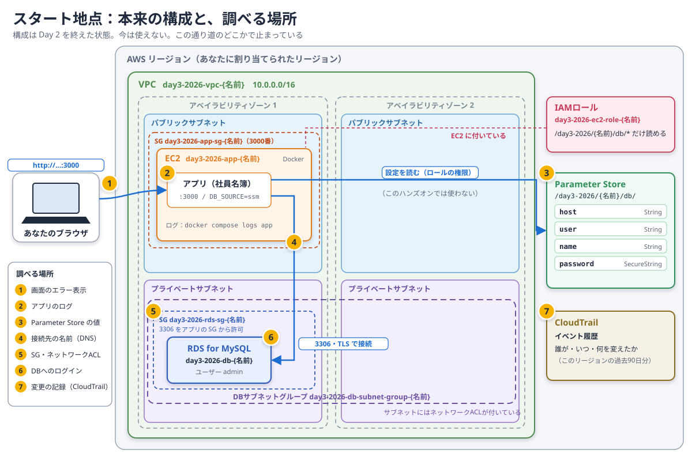
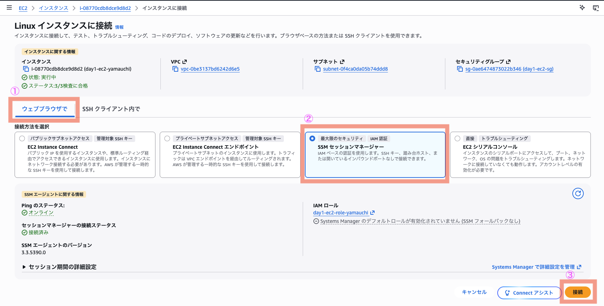
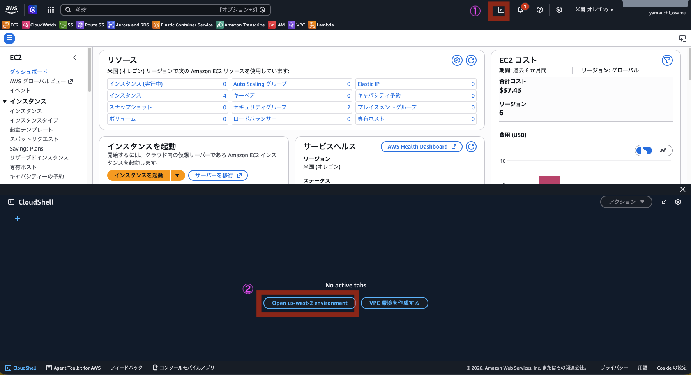

# Day 3: 障害の原因を切り分けて、復旧する

## 目標

使えなくなった社員名簿を、根拠を集めて原因を絞り込み、元どおりに使える状態へ戻します。

- 推測で設定を変えず、画面・ログ・変更の記録から原因の見当を付ける。
- 外側から順に、どこまで届いていて、どこで止まっているかを確かめる。
- 変更は小さく1つずつ行い、復旧は利用者の操作まで確かめる。

ここで扱う考え方は、事前学習の4章（外側から順に切り分ける）、5章（エラーメッセージで段階を見分ける）、6章（記録を見る）、7章（復旧）、8章（復旧の確認）で説明しています。

## 構成

講師が、あなた専用の環境を用意しています。構成は、Day 2 を終えた状態と同じです。アプリケーション（社員名簿）は、Parameter Store から接続情報を読み、RDS につながって動いていました。



今は使えません。この通り道のどこかで止まっています。図の①〜⑦は、このページの手順で調べる場所です。番号の順は、事前学習4章の「外側から順に」に合わせています。

## 重要: リソース名の命名規則

共有のAWSアカウントを使うため、**自分の名前が付いたリソース以外は、変更・削除しないでください。** このハンズオンでは、新しいリソースは作りません。

## 講師から配られる値（例）

| 項目 | 例 |
| --- | --- |
| 自分のリージョン | `us-west-2` |
| 自分の名前 | `tanaka` |

手順の中の `{あなたの名前}` は、配られた値に置き換えてください。作業はすべて、コンソール右上で自分のリージョンを選んだ状態で行います。

| リソース | 名前 |
| --- | --- |
| VPC | `day3-2026-vpc-{あなたの名前}` |
| EC2 | `day3-2026-app-{あなたの名前}` |
| アプリケーションのセキュリティグループ | `day3-2026-app-sg-{あなたの名前}` |
| RDS | `day3-2026-db-{あなたの名前}` |
| RDSのセキュリティグループ | `day3-2026-rds-sg-{あなたの名前}` |
| パラメータ | `/day3-2026/{あなたの名前}/db/host`、`/user`、`/name`、`/password` |
| EC2のIAMロール | `day3-2026-ec2-role-{あなたの名前}` |

## 状況

利用者から「社員名簿が使えない」と連絡がありました。昨日までは使えていました。

あなたは運用の担当者です。原因を見つけて、元どおり使える状態に戻してください。

## 進め方の約束

- **推測で設定を変えない。** 変える前に、なぜそこを変えるのかの根拠を確かめます。
- **変更は1つずつ。** 1つ変えたら、その結果を確かめてから次に進みます。
- **その場しのぎをしない。** 次のことはしません。
  - セキュリティグループで 3306 を `0.0.0.0/0` に開ける
  - IAMロールに `AdministratorAccess` などの強い権限を付ける
  - RDS を作り直す、スナップショットから戻す
- **手元にメモを取る。** 何を見て、何が分かったか。何を、いつ、どう変えたか。

---

## 手順1：影響を確かめる（①）

1. **EC2** を開き、`day3-2026-app-{あなたの名前}` の「パブリック IPv4 アドレス」を確かめる。
2. ブラウザで `http://{パブリックIPv4アドレス}:3000` を開く。
3. 画面上部の「接続先」と、その下に出ているメッセージを、そのままメモする。

画面が表示されるなら、アプリケーションは動いています。止まっているのは、その先です。

## 手順2：アプリケーションの状態とログを見る（②）

1. **EC2** で `day3-2026-app-{あなたの名前}` を選び、「接続」を選ぶ。「ウェブブラウザで」タブで「SSM セッションマネージャー」を選び、「接続」を押す。

   

2. 開いたターミナルで、`ubuntu` ユーザーに切り替え、アプリケーションのディレクトリへ移動する。以降のコマンドは、すべてこのディレクトリで実行する。

   ```bash
   sudo su - ubuntu
   cd ~/strong-system-dot-com/docs/2026/app
   ```

3. アプリケーションのコンテナの状態と、ログを見る。

   ```bash
   docker compose ps
   docker compose logs --tail 30 app
   ```

アプリケーションは、起動したときに Parameter Store から接続情報を読みます。読めたときは、ログの最初のほうに接続先が出ます（`DB_SOURCE=ssm host=... database=...`）。読めなかったときは、`設定の読み込みに失敗しました` と、その理由が出ます。エラーが出ていれば、その時刻と内容をメモします。

同じログは、**CloudWatch Logs** でも見られます。EC2 に入らなくても見られ、アプリケーションや EC2 が止まってもログは残ります。

1. **CloudWatch** を開き、左メニューの「ログ」→「ログ管理」を選ぶ。「ロググループ」タブが開く。
2. `/day3-2026/{あなたの名前}/app` を開き、ログストリーム `app` を選ぶ。

ログは時刻の順に並んでいます。検索欄に `Error` と入れると、その文字を含む行だけに絞れます。

設定ファイル `.env` の中身も確かめておきます。

```bash
cat .env
```

`PARAM_PREFIX` は、アプリケーションが接続情報を読む Parameter Store の場所です。

### コラム：なぜ CloudWatch Logs にログがあるのか

アプリケーション自身は、CloudWatch のことを何も知りません。ログを画面（標準出力）に書いているだけです。それを CloudWatch Logs へ送っているのは、アプリケーションを動かしている Docker です。

- **送る役：** Docker のログドライバー `awslogs` が、コンテナの出力をそのまま CloudWatch Logs へ送ります。設定は `docker-compose.cloudwatch.yml` にあり、`.env` の `COMPOSE_FILE` で読み込んでいます。`LOG_GROUP` が送り先です。
- **送る権限：** EC2 の IAM ロール `day3-2026-ec2-role-{あなたの名前}` に、このロググループへ書き込む許可があります。アクセスキーは、どこにも置いていません。
- **受け取る場所：** ロググループ `/day3-2026/{あなたの名前}/app` は、講師が環境と一緒に作りました。ログは1週間残ります。

ログを EC2 の外に置いておくと、EC2 に入らなくても見られます。EC2 が止まったり作り直されたりしても、ログは消えません。ほかにも、ファイルに書いたログを CloudWatch エージェントで送る方法などがあります。どの方法でも、「誰が送るか」「その権限はどこにあるか」「どこに届くか」の3つを押さえれば、仕組みは同じです。

## 手順3：変更の記録を見る（⑦）

「昨日まで使えていた」なら、昨日から今日までに何が変わったかが、大きな手掛かりです（事前学習6.3）。

### 3-1. コンソールで見る

1. **CloudTrail** を開き、左メニューの「イベント履歴」を選ぶ。
2. 検索の条件で「読み取り専用」を選び、`false` を指定する。参照だけの操作が除かれ、何かを作成・変更・削除した操作だけになります。
3. 右上の時間の範囲を「1日」にする。
4. 一覧で、「イベント名」「イベント時間」「ユーザー名」「リソース名」を見る。

たくさん並んでいて、どれが手掛かりか分からないと思います。それが普通です。講師が環境を作ったときの記録（ユーザー名が `AWSCloudFormation` など）と、そのあとに人が変えた記録が混ざっています。共有のアカウントなので、ほかの受講者の記録も並んでいます。

### 3-2. コマンドで絞り込む

探したいのは、**自分の環境ができた後**に、**人が変えた**記録です。CloudShell で、条件を付けて絞り込みます。

1. コンソール上部の CloudShell のアイコンを選び、CloudShell を開く。リージョンは、自分のリージョンのままにする。

   

2. 自分の名前を、変数 `NAME` に入れる。`tanaka` の部分だけを、配られた自分の名前に書き換えてから実行します。

   ```bash
   NAME=tanaka
   ```

3. 自分の環境ができた時刻と、RDS のセキュリティグループの ID を、変数に入れる。そのまま貼り付けて実行します。

   ```bash
   since=$(aws cloudformation describe-stacks --stack-name "day3-2026-$NAME" --query 'Stacks[0].CreationTime' --output text)
   RDS_SG=$(aws cloudformation describe-stacks --stack-name "day3-2026-$NAME" --query "Stacks[0].Outputs[?OutputKey=='RdsSecurityGroupId'].OutputValue" --output text)
   echo "$NAME $since $RDS_SG"
   ```

   名前、時刻、`sg-` で始まる ID の3つが表示されれば準備できています。CloudShell を開き直したときは、2 からやり直します。

4. 調べたいものごとに、次のコマンドで絞り込む。どれも、そのまま貼り付けて実行します。記録の残り方がものによって違うため、絞り込み方も変わります。

   **Parameter Store の変更**

   パラメータの変更は、一覧の「リソース名」に名前が残りません。イベント名 `PutParameter` で絞ってから、記録の中身にあるパラメータ名で、自分の分だけを取り出します。

   ```bash
   aws cloudtrail lookup-events --start-time "$since" --lookup-attributes AttributeKey=EventName,AttributeValue=PutParameter --query 'Events[].CloudTrailEvent' --output json | jq -r --arg prefix "/day3-2026/$NAME/" '.[] | fromjson | select(.requestParameters.name | startswith($prefix)) | select(.userIdentity.invokedBy != "cloudformation.amazonaws.com") | [.eventTime, .userIdentity.userName, .requestParameters.name] | @tsv'
   ```

   **セキュリティグループの変更**

   セキュリティグループの変更は、「リソース名」にセキュリティグループの ID が残ります。3 で変数に入れた、RDS のセキュリティグループの ID で絞ります。

   ```bash
   aws cloudtrail lookup-events --start-time "$since" --lookup-attributes AttributeKey=ResourceName,AttributeValue="$RDS_SG" --query "Events[?Username!='AWSCloudFormation'].[EventTime,EventName,Username]" --output table
   ```

   **IAM の変更**

   IAM は、リージョンを持たないサービスです。記録は、どのリージョンで操作しても **us-east-1** に残ります。リージョンを指定し、ロール名で絞ります。

   ```bash
   aws cloudtrail lookup-events --region us-east-1 --start-time "$since" --lookup-attributes AttributeKey=ResourceName,AttributeValue="day3-2026-ec2-role-$NAME" --query "Events[?Username!='AWSCloudFormation'].[EventTime,EventName,Username]" --output table
   ```

どのコマンドも、環境ができた時刻より後の記録だけにし、CloudFormation が環境を作ったときの記録を除いています。残ったものが、あとから人が変えた記録です。何も表示されなければ、そのものは変えられていません。

見つけた変更は、時刻・ユーザー名・内容をメモします。ただし、まだ直しません。手順4で、その変更が本当に障害の原因かを確かめてから直します。

## 手順4：4つの障害を1つずつ直す（③〜⑥）

障害は4つあります。外側から順に、1つずつ見えてきます。1つ直すと、次の障害のエラーが見えます。

どの障害も、同じ流れで進めます。

1. 画面とログのエラーを見て、止まっている段階を考える。
2. その段階を、EC2 から直接確かめる。
3. 原因を**1つだけ**直す。
4. アプリケーションを起動し直し、エラーが変わったかを確かめる。

自分で確かめてから直すのが基本ですが、時間は限られています。詰まったら、各障害の「答えを見る」を開いてください。新しいタブで開きます。

### 4-0. 準備

**エラーと段階の対応**

画面やログのエラーを、事前学習5章の表に当てはめます。

| エラーの例 | 止まっている段階 | 次に確かめる場所 |
| --- | --- | --- |
| パラメータが見つからない、`AccessDeniedException` | 設定を読む | ③ Parameter Store の値、IAMロール |
| `ENOTFOUND` | 名前を引く | ③ `host` の値、④ 接続先の名前 |
| `ETIMEDOUT`（しばらく待たされてから失敗） | 通信を始める | ⑤ セキュリティグループ、ネットワークACL |
| `Access denied for user` | ログインする | ③ `user` と `password` の値、⑥ DBへのログイン |

**本当の接続先を変数に入れる**

確かめるときは、アプリケーションを通さず、EC2 から直接試すと切り分けやすくなります。**Aurora and RDS** で `day3-2026-db-{あなたの名前}` を開き、「接続とセキュリティ」タブの「エンドポイント」をコピーして、EC2 のターミナルで変数に入れます。

```bash
DB_HOST='{エンドポイント}'
```

**Parameter Store の正しい値**

**Systems Manager** の「パラメータストア」で、`/day3-2026/{あなたの名前}/db/` の4つを確かめられます。`password` は「表示」を選ぶと見られます。正しい値は次のとおりです。

| パラメータ | 正しい値 |
| --- | --- |
| `host` | 上でコピーした RDS のエンドポイント |
| `user` | `admin` |
| `name` | `employee_db` |
| `password` | Day 2 と同じ研修用パスワード `Tr41n-Rds2026-Kq7mZx` |

**アプリケーションを起動し直すコマンド**

アプリケーションは、**起動したときにだけ** Parameter Store から接続情報を読みます（事前学習7.3）。また、セキュリティグループを直した後も、古い接続が残っていることがあります。1つ直すたびに、次のコマンドで起動し直します。

```bash
docker compose up -d --force-recreate --no-deps app
docker compose logs --tail 10 app
```

`--no-deps` は、このディレクトリにあるローカルの MySQL のコンテナを起動しないための指定です。Day 3 のアプリケーションは RDS だけを使います。

### 4-1. 障害1：設定を読めない（③）

1. 画面とログに `AccessDeniedException` が出ていることを確かめる。止まっている段階は「設定を読む」です。アプリケーションは、Parameter Store から接続情報を読めていません。メッセージを最後まで読み、どのロールが、どのパラメータの読み取りを、どんなポリシーで断られたかをメモする。
2. EC2 から、アプリケーションと同じロールの権限で、パラメータを読んでみる。`{あなたのリージョン}` と `{あなたの名前}` は置き換える。

   ```bash
   aws ssm get-parameters --region {あなたのリージョン} --names /day3-2026/{あなたの名前}/db/host
   ```

   値が表示されれば、読めています。`AccessDeniedException` なら、EC2 のロールの権限で断られています。

3. **IAM** の「ロール」で `day3-2026-ec2-role-{あなたの名前}` を開き、「許可」タブでインラインポリシー `day3-2026-read-my-params` の JSON を見る。正しくは、次の2つです。Day 2 で見たポリシーと同じ考え方です。
   - `Allow`：自分のパラメータ `/day3-2026/{あなたの名前}/db/*` の読み取りを許可する。
   - `Deny`：自分のパラメータ**以外**の読み取りを拒否する。`NotResource` に、自分のパラメータのパスを書く。

   明示的な拒否は、許可より優先されます（Day 1）。
4. 正しい状態と違うところを、1か所だけ直す。`Deny` を消したり、強い権限を付けたりしてはいけません。ほかの受講者のパラメータまで読めるようになります。
5. 2 のコマンドで値が表示されることを確かめてから（反映に数秒かかることがあります）、アプリケーションを起動し直し、ブラウザを再読み込みする。`AccessDeniedException` が消えて、別のエラーに変われば、障害1は解決です。

<a href="answer-1.html" target="_blank" rel="noopener noreferrer">障害1の答えを見る</a>

### 4-2. 障害2：名前を引けない（④）

1. 画面とログに `ENOTFOUND` が出ていることを確かめる。止まっている段階は「名前を引く」です。
2. ログの最初の行（`DB_SOURCE=ssm host=...`）にある、アプリケーションが使っている接続先をメモする。
3. 本当の接続先と、アプリケーションが使っている接続先の両方で、名前を引いてみる。

   ```bash
   getent hosts "$DB_HOST"
   getent hosts '{ログの host= の値}'
   ```

   IP アドレスが表示されれば、名前は引けています。何も表示されなければ、その名前は見つかりません。

4. 2つの名前を1文字ずつ比べ、アプリケーションがどこから接続先を読んでいるかを考えて、1か所だけ直す。
5. アプリケーションを起動し直し、ブラウザを再読み込みする。`ENOTFOUND` が消えて、別のエラーに変われば、障害2は解決です。

<a href="answer-2.html" target="_blank" rel="noopener noreferrer">障害2の答えを見る</a>

### 4-3. 障害3：3306 に届かない（⑤）

1. 画面とログに `ETIMEDOUT` が出ていることを確かめる。しばらく待たされてから失敗します。止まっている段階は「通信を始める」です。
2. EC2 から、RDS の 3306 番ポートに届くかを試す。

   ```bash
   timeout 5 bash -c "</dev/tcp/$DB_HOST/3306" && echo "届いた" || echo "届かない"
   ```

   `届かない` が、すぐに出たか、5秒待たされてから出たかも見ます（事前学習5.2）。待たされてから出たなら、途中で止められています。

3. 途中で止めているものを確かめる。
   - **EC2** の「セキュリティグループ」で `day3-2026-rds-sg-{あなたの名前}` を開き、「インバウンドルール」を見る。正しくは、タイプ「MYSQL/Aurora」（3306）、ソースが `day3-2026-app-sg-{あなたの名前}` です。
   - RDS に、実際にそのセキュリティグループが付いているか（RDS の「接続とセキュリティ」タブ）。
4. 正しい状態と違うところを、1か所だけ直す。ソースを `0.0.0.0/0` にしてはいけません。
5. 上の `/dev/tcp` で `届いた` になることを確かめてから、アプリケーションを起動し直し、ブラウザを再読み込みする。`ETIMEDOUT` が消えて、別のエラーに変われば、障害3は解決です。

<a href="answer-3.html" target="_blank" rel="noopener noreferrer">障害3の答えを見る</a>

### 4-4. 障害4：ログインできない（⑥）

1. 画面とログに `Access denied for user` が出ていることを確かめる。待たされず、すぐに失敗します。止まっている段階は「ログインする」です。
2. EC2 から、研修用パスワードで DB にログインしてみる。

   ```bash
   docker run --rm mysql:8.4.5 mysql -h "$DB_HOST" -u admin -p'Tr41n-Rds2026-Kq7mZx' --ssl-mode=REQUIRED -e "SELECT 1"
   ```

   Day 2 と同じく、`-p` の直後に空白を入れずに研修用パスワードを書いています。`Using a password on the command line interface can be insecure.` という警告が出ますが、気にしなくて構いません。`1` が表示されれば、研修用パスワードでログインできます。RDS は正常です。

3. 研修用パスワードでログインできるのに、アプリケーションは断られています。アプリケーションが使っている値を、4-0 の表と比べる。これは DB のログインのエラーです。IAM ロールを変えても直りません（事前学習5.3）。
4. 違っている値を、1か所だけ直す。
5. アプリケーションを起動し直し、ブラウザを再読み込みする。「接続先」が水色の **Amazon RDS** になり、社員一覧が表示されれば、障害4は解決です。手順5に進みます。

<a href="answer-4.html" target="_blank" rel="noopener noreferrer">障害4の答えを見る</a>

## 手順5：復旧を確かめる

画面上部の「接続先」が水色の **Amazon RDS** になり、エラーが消えたら、利用者の操作まで確かめます（事前学習8.1）。

1. 社員一覧に、`E001`〜`E010` の社員が表示される。
2. 「新規従業員登録」で、従業員ID `Z-{あなたの名前}`、メールアドレス `z-{あなたの名前}@example.com` の社員を1件登録できる。そのほかの項目は好きな値でよい。
3. 登録した `Z-{あなたの名前}` を「編集」で変更し、保存できる。

## 手順6：記録を残す

メモをもとに、障害の記録を書きます。目的は、誰のせいかを決めることではなく、同じことを繰り返さないことです（事前学習8.2）。

1. 全体について、次の3つを書く。
   - **影響**：何が、いつから、いつまで使えなかったか。
   - **最初に見えたこと**：画面とログに、何が出ていたか。
   - **復旧の確認**：手順5で、何を確かめたか。
2. 直した障害ごとに、次の3つを1行ずつ書く。
   - **原因**：何が、どう変わっていたか。
   - **根拠**：どの画面・ログ・コマンドの結果で、そう言えるか。
   - **復旧**：何を、どの値に戻したか。
3. 最後に、**再発を防ぐには**を1つ書く。「気を付ける」ではなく、人が間違えても止まる、または、すぐに気付ける形を考える。

書き終えたら、<a href="record-example.html" target="_blank" rel="noopener noreferrer">記録の例</a>と見比べてください。

## 余裕がある人へ

ここまで終わったら、講師に声をかけてください。もう1つ、別の障害を入れます。同じ進め方で、原因を探して直してください。

<a href="answer-5.html" target="_blank" rel="noopener noreferrer">追加の障害の答えを見る</a>

## 後片付け

このハンズオンでは、新しいリソースは作っていません。Session Manager のセッションを終了するだけです。環境は講師が削除します。

## 詰まった場合

| 状況 | 確認すること |
| --- | --- |
| どこを直せばよいか見当が付かない | いま取り組んでいる障害の「答えを見る」を開く |
| IAM のポリシーを直したのに、`AccessDeniedException` が消えない | 数秒待ってから、`aws ssm get-parameters` をもう一度試したか。`NotResource` の2つのパスを、両方とも直したか |
| 直したのに、画面が変わらない | 4-0 のコマンドでアプリケーションを起動し直したか。ブラウザを再読み込みしたか |
| CloudTrail に何も見つからない | コンソール右上のリージョンが、自分のリージョンか。「読み取り専用」を `false` にしたか。時間の範囲が短すぎないか |
| CloudTrail に記録がたくさんあって分からない | 3-2 のコマンドで絞り込む |
| 3-2 のコマンドで何も表示されない | `echo "$NAME $since $RDS_SG"` で3つとも表示されるか。CloudShell を開き直したら、3-2 の 2 からやり直す |
| `getent hosts` で何も表示されない | `DB_HOST` に、RDS のコンソールからコピーしたエンドポイントを入れたか。前後に空白が入っていないか |
| 3306 に `届かない` のに、セキュリティグループは正しい | RDS に付いているセキュリティグループと、ネットワークACLも確かめたか |
| `docker run` でも `Access denied` | コマンドをそのままコピーしたか。`-p` とパスワードの間に空白が入っていないか。それでも同じなら、講師に声をかける |
| 何を変えたか分からなくなった | メモを見直す。分からなければ、講師に声をかける |
