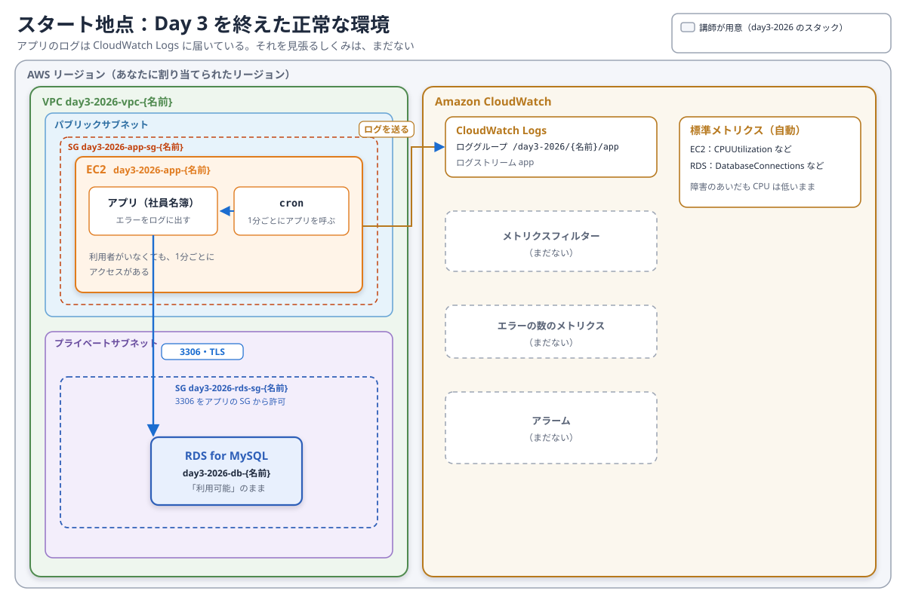
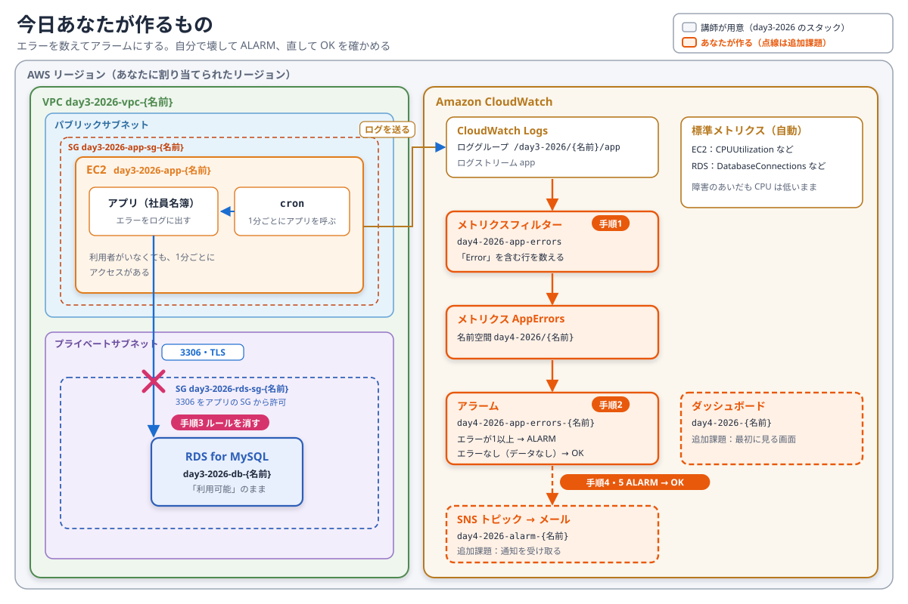

# Day 4: 障害に、利用者より先に気付く（CloudWatch のアラーム）

## 目標

アプリケーションのエラーを CloudWatch で数え、エラーが出たら知らせるアラームを作ります。自分で障害を起こしてアラームが鳴ることを確かめ、直してアラームが元に戻ることを確かめます。

- アプリケーションのログから、エラーの数をメトリクスにする（メトリクスフィルター）。
- エラーが出たら `ALARM` になるアラームを作る。正常なときにデータがないことも考えて設定する。
- 障害のあいだ、CPU や RDS の状態は「正常」に見えることを確かめる。

ここで扱う考え方は、事前学習の1章（監視の目的）、4章（CloudWatch Logs）、5章（アラーム）、6章（アラームの設計）で説明しています。

## 構成

講師が、あなた専用の環境を用意しています。**Day 3 と同じ環境**なので、リソース名には `day3-2026` が付いています。Day 3 の障害は入っておらず、正常に動いています。

EC2 では、cron が1分ごとにアプリケーションを呼んでいます。利用者のアクセスの代わりです。アプリケーションは、障害が起きるとエラーをログに出し、そのログは CloudWatch Logs に届いています。ただ、そのログを見張るしくみは、まだありません。

今日あなたが作るのは、オレンジの部分です。図の番号は、このページの手順の番号と同じです。点線は追加課題です。

## 重要: リソース名の命名規則

共有のAWSアカウントを使うため、**作るものの名前には `{あなたの名前}` を付けてください。** 自分の名前が付いたリソース以外は、変更・削除しないでください。

## 講師から配られる値（例）

| 項目 | 例 |
| --- | --- |
| 自分のリージョン | `us-west-2` |
| 自分の名前 | `tanaka` |

手順の中の `{あなたの名前}` は、配られた値に置き換えてください。作業はすべて、コンソール右上で自分のリージョンを選んだ状態で行います。

| 講師が用意したリソース | 名前 |
| --- | --- |
| EC2 | `day3-2026-app-{あなたの名前}` |
| RDS | `day3-2026-db-{あなたの名前}` |
| RDS のセキュリティグループ | `day3-2026-rds-sg-{あなたの名前}` |
| アプリケーションのセキュリティグループ | `day3-2026-app-sg-{あなたの名前}` |
| アプリケーションのロググループ | `/day3-2026/{あなたの名前}/app` |

| あなたが作るもの | 名前 |
| --- | --- |
| メトリクスフィルター | `day4-2026-app-errors` |
| メトリクス | 名前空間 `day4-2026/{あなたの名前}`、メトリクス名 `AppErrors` |
| アラーム | `day4-2026-app-errors-{あなたの名前}` |
| SNS トピック（追加課題） | `day4-2026-alarm-{あなたの名前}` |
| ダッシュボード（追加課題） | `day4-2026-{あなたの名前}` |

---

## 手順0：正常に動いていることを確かめる

1. **EC2** を開き、`day3-2026-app-{あなたの名前}` の「パブリック IPv4 アドレス」を確かめる。
2. ブラウザで `http://{パブリックIPv4アドレス}:3000` を開き、「接続先」が水色の **Amazon RDS** で、社員一覧が表示されることを確かめる。
3. **CloudWatch** を開き、左メニューの「ログ」→「ロググループ」で `/day3-2026/{あなたの名前}/app` を開く。ログストリーム `app` を選び、中身を見る。

正常なときのアプリケーションは、起動したときの1行（`DB_SOURCE=ssm host=...`）のほかは、ほとんど何もログに出しません。エラーが起きたときにだけ、`Error: ...` で始まる行を出します。

## 手順1：エラーを数えるメトリクスフィルターを作る

ログはそのままでは数えられません。「`Error` を含む行が出たら1と数える」メトリクスフィルターを作り、エラーの数をメトリクスにします（事前学習4章）。

1. 手順0のロググループ `/day3-2026/{あなたの名前}/app` を開き、「メトリクスフィルター」タブ →「メトリクスフィルターを作成」を選ぶ。
2. 「フィルターパターン」に `Error` と入力し、「次へ」を選ぶ。大文字と小文字は区別されます。
3. 次のとおり設定する。

   | 項目 | 設定 |
   | --- | --- |
   | フィルター名 | `day4-2026-app-errors` |
   | メトリクス名前空間 | `day4-2026/{あなたの名前}` |
   | メトリクス名 | `AppErrors` |
   | メトリクス値 | `1` |
   | デフォルト値 | 空欄のまま |

4. 「次へ」→「メトリクスフィルターを作成」を選ぶ。

メトリクス値の `1` は、「1行見つかるごとに1と数える」という意味です。名前空間に自分の名前を入れるのは、同じリージョンのほかの受講者のメトリクスと混ざらないようにするためです。

## 手順2：エラーが出たら知らせるアラームを作る

1. ロググループの「メトリクスフィルター」タブで、手順1の `day4-2026-app-errors` を選び、「アラームを作成」を選ぶ。

   エラーがまだ一度も出ていないので、このメトリクスにはデータがありません。データのないメトリクスは、アラームの作成画面の一覧には出てきません。そのため、メトリクスフィルターの画面からアラームを作ります。

2. 「メトリクスと条件の指定」で、次のとおり設定する。

   | 項目 | 設定 |
   | --- | --- |
   | 統計 | 合計 |
   | 期間 | 1分 |
   | しきい値の種類 | 静的 |
   | 条件 | `AppErrors` が「以上」`1` |
   | 追加設定 → アラームを実行するデータポイント | `1` / `1` |
   | 追加設定 → 欠落データの処理 | 欠落データを良好（しきい値を超えていない）として処理 |

3. 「次へ」を選ぶ。「通知」は、今は設定しない。設定欄があれば「削除」して、「次へ」を選ぶ。
4. 「アラーム名」に `day4-2026-app-errors-{あなたの名前}` を入力する。「アラームの説明」に、鳴ったときに最初に見るものを書いておく（例：`アプリのDB接続エラー。まずロググループ /day3-2026/{あなたの名前}/app を見る`）。
5. 「次へ」→「アラームの作成」を選ぶ。

**欠落データを「良好」として扱う理由**：正常なとき、アプリケーションはエラーのログを出しません。そのため、正常なあいだは、このメトリクスにデータが届きません。既定のまま（欠落データとして扱う）だと、正常なのに「データ不足」になってしまいます（事前学習5章）。

左メニューの「アラーム」→「すべてのアラーム」で、自分のアラームの状態が **OK** になることを確かめます。作った直後は「データ不足」と表示されることがあります。少し待って、画面を更新してください。

## 手順3：自分で障害を起こす

RDS のセキュリティグループから、アプリケーションからの接続を許可するルールを消します。Day 3 で見た「誰かがルールを消した」障害を、今度は自分で起こします。

1. **EC2** の左メニュー「セキュリティグループ」で `day3-2026-rds-sg-{あなたの名前}` を開く。
2. 「インバウンドルール」タブ →「インバウンドのルールを編集」を選ぶ。
3. タイプ「MYSQL/Aurora」（ポート3306）、ソース `day3-2026-app-sg-{あなたの名前}` のルールを「削除」し、「ルールを保存」を選ぶ。
4. **今の時刻をメモする。**

## 手順4：アラームが鳴ることを確かめる

ブラウザでアプリケーションを再読み込みすると、しばらく待たされたあとに「接続できていません」になります。cron の1分ごとのアクセスも、同じように失敗しています。

1. **CloudWatch** の「アラーム」→「すべてのアラーム」で、画面を更新しながら待つ。自分のアラームが **ALARM**（「アラーム状態」）になったら、その時刻をメモする。
2. アラームを選び、グラフを見る。`AppErrors` の値が出ている時間帯を確かめる。
3. ロググループ `/day3-2026/{あなたの名前}/app` を開き、1分ごとに `Error: ... ETIMEDOUT` などの行が出ていることを確かめる。

**期待結果：手順3でルールを消してから少したつと、アラームが ALARM になる。** 手順3でメモした時刻から、何分で気付けたかを確かめてください。

障害のあいだ、ほかの見え方も確かめます（事前学習1章）。

- **EC2** で自分のインスタンスを選び、「モニタリング」タブの「CPU 使用率」を見る。CPU は低いままです。
- **Aurora and RDS** で `day3-2026-db-{あなたの名前}` を開く。状態は「利用可能」のままです。

CPU や RDS の状態だけを見張っていたら、この障害には気付けませんでした。利用者に見える症状（ここではアプリケーションのエラー）を見張る理由です。

## 手順5：直して、アラームが OK に戻ることを確かめる

1. 手順3と同じ画面で「インバウンドのルールを編集」→「ルールを追加」を選ぶ。
2. タイプ「MYSQL/Aurora」、ソース「カスタム」で `day3-2026-app-sg-{あなたの名前}` を選び、「ルールを保存」を選ぶ。
3. ブラウザでアプリケーションを再読み込みし、社員一覧が表示されることを確かめる。
4. 「すべてのアラーム」で、自分のアラームが **OK** に戻ることを確かめる。

アプリケーションを起動し直す必要はありません。このアプリケーションは、アクセスのたびに新しくDBへ接続するため、ルールを戻すと、次のアクセスから接続できます。エラーのログが出なくなると、データが届かなくなり、欠落データを「良好」として扱う設定によって OK に戻ります。

## 手順6：振り返る

次のことを短くメモします。

- ルールを消してから、何分でアラームが鳴ったか。もっと早く気付くには、何を変えればよいか。
- 障害のあいだ、CPU と RDS の状態はどう見えていたか。
- アラームが鳴ったとき、最初に何を見ればよいか（アラームの説明に書いたことで足りたか）。

## 追加課題1：通知をメールで受け取る

アラームが鳴っても、コンソールを見ていなければ気付けません。メールで受け取れるようにします（事前学習5章）。

1. 「すべてのアラーム」で自分のアラームを選び、「アクション」→「編集」を選ぶ。「次へ」で「アクションの設定」まで進む。
2. 「通知を追加」を選び、次のとおり設定する。

   | 項目 | 設定 |
   | --- | --- |
   | アラーム状態トリガー | アラーム状態 |
   | SNS トピックの選択 | 新しいトピックの作成 |
   | トピック名 | `day4-2026-alarm-{あなたの名前}` |
   | 通知を受け取る E メールエンドポイント | 自分のメールアドレス |

3. 「トピックの作成」を選ぶ。
4. もう一度「通知を追加」を選び、アラーム状態トリガー「OK」、SNS トピック「既存の SNS トピックを選択」で `day4-2026-alarm-{あなたの名前}` を選ぶ。直ったときにも知らせてもらうためです。
5. 「次へ」→「アラームの更新」を選ぶ。
6. 届いた確認メールの「Confirm subscription」を選ぶ。**確認するまで、通知は届きません。**
7. 手順3〜5をもう一度行い、ALARM と OK のメールが届くことを確かめる。

## 追加課題2：最初に見るダッシュボードを作る

アラームが鳴ったときに最初に開く画面を作ります（事前学習7章）。

1. **CloudWatch** の左メニュー「ダッシュボード」→「ダッシュボードの作成」を選び、名前に `day4-2026-{あなたの名前}` を入力する。
2. 次のウィジェットを追加する。

   | ウィジェット | 中身 |
   | --- | --- |
   | アラームのステータス | 自分のアラーム `day4-2026-app-errors-{あなたの名前}` |
   | 折れ線 | `day4-2026/{あなたの名前}` の `AppErrors` |
   | 折れ線 | EC2 の `CPUUtilization`（自分のインスタンス） |
   | 折れ線 | RDS の `DatabaseConnections`（自分の DB） |

3. 「ダッシュボードの保存」を選ぶ。

手順3〜5をもう一度行うと、エラーが増えても CPU が変わらないことを、1つの画面で見られます。

## 後片付け

1. 手順5で、RDS のセキュリティグループのルールを戻したことを確かめる。
2. 作ったもの（メトリクスフィルター、アラーム、SNS トピック、ダッシュボード）は、講師が削除します。削除しないでください。

## 詰まった場合

| 状況 | 確認すること |
| --- | --- |
| ロググループにログが見当たらない | コンソール右上のリージョンが、自分のリージョンか。ログストリーム `app` を選んだか |
| アラームの作成画面に `AppErrors` が出てこない | 手順2の1のとおり、ロググループの「メトリクスフィルター」タブからアラームを作る |
| アラームがずっと「データ不足」 | 欠落データの処理が「良好（しきい値を超えていない）」になっているか |
| ルールを消しても、アラームが鳴らない | ブラウザに「接続できていません」と出ているか。ロググループに `Error` の行が出ているか。フィルターパターンが `Error`（大文字と小文字）か。メトリクス名前空間とメトリクス名が手順1のとおりか |
| ルールを戻しても、アラームが ALARM のまま | アプリケーションの画面が正常に戻っているか。戻っていれば、1〜2分待って画面を更新する |
| 確認メールが届かない | 迷惑メールのフォルダ。メールアドレスの打ち間違い。届かなければ、講師に声をかける |
| 通知のメールが届かない | 確認メールの「Confirm subscription」を選んだか |
