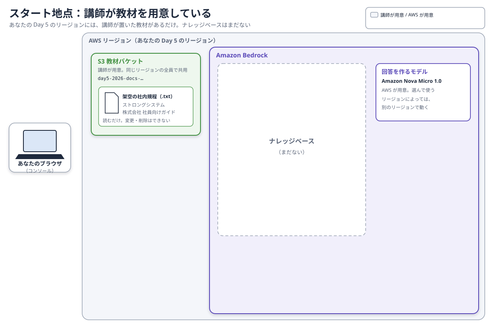
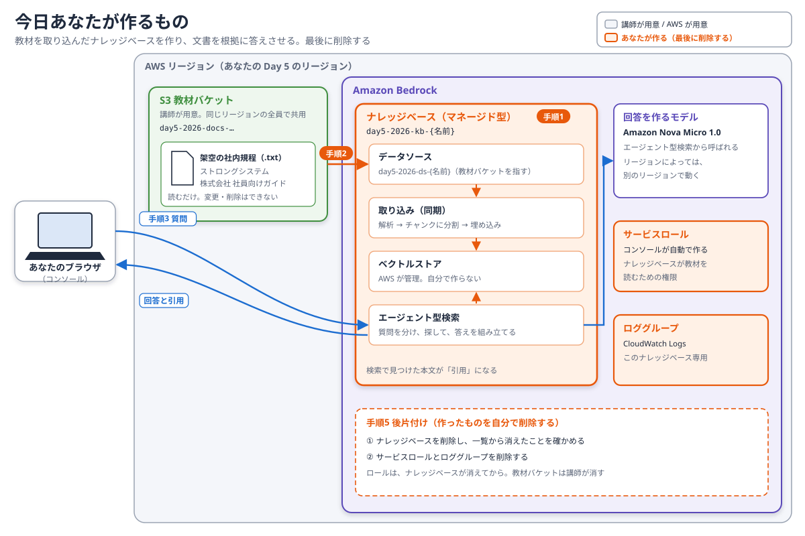

# Day 5: 社内の文書を根拠に答えさせる（Amazon Bedrock のナレッジベース）

## 目標

講師が用意した架空の社内規程を、Amazon Bedrock のナレッジベースに取り込みます。質問への答えが、文書のどこを根拠にしているかを確かめます。

- マネージド型のナレッジベースを作り、文書を同期（取り込み）する。
- 文書に答えがある質問と、答えがない質問を対にして試す。
- 回答の引用元を開き、本文と回答が一致しているかを確かめる。
- 作ったものを、自分で削除する。

ここで扱う考え方は、事前学習の3章（検索拡張生成）、4章（ナレッジベースのしくみ）、5章（よい回答と悪い回答）、8章（回答を評価する）で説明しています。

## 構成

**Day 5 は、Day 1〜4 と違うリージョンを使います。** マネージド型のナレッジベースが使えるリージョンが限られているためです。講師から配られる「Day 5 のリージョン」で作業してください。

あなたの Day 5 のリージョンには、講師が置いた教材があるだけです。



今日あなたが作るのは、オレンジの部分です。図の番号は、このページの手順の番号と同じです。作ったものは、最後に自分で削除します。



## 重要: リソース名の命名規則

共有のAWSアカウントを使うため、**作るものの名前には `{あなたの名前}` を付けてください。** 自分の名前が付いたリソース以外は、変更・削除しないでください。教材のバケットは、同じリージョンの全員で共用します。変更・削除しないでください。

## 講師から配られる値（例）

| 項目 | 例 |
| --- | --- |
| 自分の名前 | `tanaka` |
| Day 5 のリージョン | `us-east-1` |
| データソース（教材バケットの S3 URI） | `s3://day5-2026-docs-…-us-east-1-an/` |
| 回答に使うモデルの選択名 | 講師が指示する（リージョンによって違う） |

| あなたが作るもの | 名前 |
| --- | --- |
| ナレッジベース | `day5-2026-kb-{あなたの名前}` |
| データソース | `day5-2026-ds-{あなたの名前}` |
| サービスロール、ロググループ | コンソールが自動で名前を付ける |

---

## 手順0：Day 5 のリージョンに切り替え、教材を確かめる

1. コンソール右上のリージョンを、配られた **Day 5 のリージョン**に切り替える。
2. **S3** を開き、配られたバケットを開く。架空の社内規程（`strong-system-rag-test-document.txt`）が1つ置かれていることを確かめる。

このファイルは、架空の会社「ストロングシステム株式会社」の社員向けガイドです。中身を開く必要はありません。

## 手順1：ナレッジベースを作る

1. **Amazon Bedrock** を開き、左メニューの「ナレッジベース」を選ぶ。メニューの場所が違う場合は、講師に声をかけてください。
2. 「マネージドナレッジベースを作成」を選ぶ。「セルフマネージド」と付いたものは選ばない。
3. 次のとおり設定する。

   | 項目 | 設定 |
   | --- | --- |
   | ナレッジベース名 | `day5-2026-kb-{あなたの名前}` |
   | 追加設定 → 埋め込みモデル | マネージド埋め込みモデル（推奨） |
   | 追加設定 → IAM のアクセス許可 | 新しいサービスロールを作成して使用 |
   | 追加設定 → 暗号化設定をカスタマイズ | オフのまま |

4. データソースを、次のとおり設定する。

   | 項目 | 設定 |
   | --- | --- |
   | データソース名 | `day5-2026-ds-{あなたの名前}` |
   | 種類 | Amazon S3 |
   | S3 URI | 配られた教材バケットの S3 URI |
   | アクセスコントロールリスト | 無効にする |
   | メタデータ、取り込みのフィルター | 空欄のまま |
   | 解析・チャンク分割 | 既定のまま |

5. 「高度な設定」を開き、次のとおりにそろえる。

   | 項目 | 設定 |
   | --- | --- |
   | デフォルトのインデックス作成 | テキストベースのコンテンツを使用 |
   | ドキュメント内のビジュアルコンテンツ、音声ファイル、動画ファイル | チェックを外す |
   | 最大ファイルサイズ | 1 MB |
   | ドキュメント削除セーフガード | オフ |
   | 同期スケジュール | オンデマンド |

6. ログの送信先を聞かれたら、既定のまま（このナレッジベース専用のロググループ）にする。
7. 「ナレッジベースを作成」を選び、状態が利用可能になるまで待つ。
8. 作成したナレッジベースを開き、次の2つを手元にメモする。後片付けで使います。
   - **ナレッジベース ID**
   - **サービスロールの名前**

アクセスコントロールリストは、文書ごとに読める人を分ける機能です。全員が同じ架空の文書を使うので、今回は使いません。ベクトルストアは AWS が管理するので、自分で作る必要はありません（事前学習4章）。

## 手順2：同期する

1. 自分のナレッジベースのデータソース一覧で `day5-2026-ds-{あなたの名前}` を選び、「同期」を選ぶ。
2. 状態が完了になるまで待つ。
3. 同期の履歴で、教材が取り込まれたこと（失敗した文書がないこと）を確かめる。

同期は、文書を読み込み、チャンクに分けて埋め込みに変え、検索できるようにする処理です。モデルを学習し直しているわけではありません（事前学習4章）。

「リクエストが多すぎる」といったエラー（スロットリング）が出たら、30秒ほど待ってから、もう一度だけ押してください。続けて何度も押さないでください（事前学習7章）。

## 手順3：質問して、引用元と照らし合わせる

### 3-1. テスト画面を設定する

1. 自分のナレッジベースの「テスト」画面を開く。
2. 「取得と応答生成」で「回答生成を使用したエージェント型検索」を選ぶ。
3. モデルの欄の編集ボタンから、Amazon の **Nova Micro 1.0** を、講師から配られた選択名で選び、「適用」を選ぶ。
4. 画面のモデルの表示が Nova Micro 1.0 になったことを確かめる。「マネージドモデル」のままにしない。「デフォルトにリセット」は押さない。
5. 「エージェントの最大反復回数」を **2** にする。

### 3-2. 質問する

**1つの答えが返ってきてから、次の質問を送ってください。** 質問は、試し直しも含めて5回までにします。

それぞれの質問の前に、次の指示を付けて送ります。

```text
これは架空の会社の研修用文書を使った演習です。
ナレッジベースの文書だけを根拠に、日本語で回答してください。
文書に答えがなければ「文書に記載がありません」と答えてください。
実在する会社の情報や一般的な制度で補わないでください。
```

まず、次の2つを必ず試します。

| 順 | 質問 | 確かめること |
| --- | --- | --- |
| 1 | ストロングシステム株式会社では、年次有給休暇を何日前までに申請しますか。緊急時の扱いも教えてください。 | 回答の引用番号（または「ソースチャンクを表示」）を開き、引用元が教材の `.txt` で、その本文が回答を裏付けているか |
| 2 | ストロングシステム株式会社の住宅手当は月額いくらですか。支給条件も教えてください。 | 金額や条件を作らず、「文書に記載がありません」と答えるか |

**期待結果：質問1は、引用された本文と回答が一致する。質問2は、文書にないことを、ないと答える。** 「それらしい答えが出た」だけでは成功としません（事前学習8章）。

余裕があれば、次の質問も試します。

- 年次有給休暇はどの単位で取得できますか。時間単位の年間上限も教えてください。
- 経費精算で領収書の原本が必要になる金額はいくらですか。
- 情報セキュリティインシデントを発見したとき、最初に誰へ連絡しますか。緊急連絡先も教えてください。

答えがおかしいときは、高いモデルに切り替える前に、手順2の同期の結果と、引用された本文を確かめます（事前学習5章）。「架空の会社だから答えられない」と断られたときは、上の指示を付けてもう一度送ります。

## 手順4（任意）：しくみをのぞく

### 4-1. 探し出された文章だけを見る

テスト画面の「取得と応答生成」を「標準検索のみ」に切り替え、手順3の質問1を送ります。回答の文章は作られず、検索で見つかったチャンク（文書の断片）が並びます。答えを作る前に、どの本文が探し出されたかが分かります（事前学習5章）。確かめたら、手順3の設定に戻します。

### 4-2. 自動で作られたロールを見る

**IAM** の「ロール」で、手順1でメモしたサービスロールを開きます。

- 「信頼関係」タブ：`bedrock.amazonaws.com` が、このロールを使えることになっている。
- 「許可」タブ：教材バケットを読むための許可が付いている。

Day 1 で EC2 にロールを渡したのと同じしくみで、ナレッジベースにも権限が渡されています。

## 手順5：後片付け

**ナレッジベースを先に削除し、消えたことを確かめてから、ロールとロググループを削除します。** ナレッジベースはこのロールを使っているので、使われているものを先に消さないようにします。

1. **Amazon Bedrock** のナレッジベースの一覧で、自分の `day5-2026-kb-{あなたの名前}` を選び、「削除」を選ぶ。
2. 確認の入力欄に、半角英字で `delete` と入力し、削除する。「削除」と日本語で入力すると、ボタンが押せないことがあります。
3. 一覧を更新し、自分のナレッジベースが消えたことを確かめる。削除中の表示が続くときは、画面を再読み込みする。
4. **CloudWatch** の「ロググループ」で、名前にメモしたナレッジベース ID を含むロググループ（`/aws/vendedlogs/bedrock/knowledge-base/APPLICATION_LOGS/{ナレッジベースID}` の形）を削除する。
5. **IAM** の「ロール」で、メモしたサービスロールを削除する。

教材のバケットは講師が削除します。削除しないでください。削除できないものが残ったら、名前を講師に伝えてください。

## 詰まった場合

| 状況 | 確認すること |
| --- | --- |
| 「マネージドナレッジベースを作成」が見つからない | コンソール右上のリージョンが、Day 5 のリージョンか（Day 1〜4 のリージョンのままになっていないか） |
| OpenSearch や S3 Vectors を選ぶ画面になった | 「セルフマネージド」を選んでいないか。作成前なら戻る |
| 同期が失敗する、取り込まれた件数が0 | S3 URI が配られたものと同じか。ナレッジベースと教材バケットのリージョンが同じか |
| スロットリング、「リクエストが多すぎる」 | 30秒ほど待ってから、もう一度だけ押す。続けて押さない |
| Nova Micro 1.0 が選べない | 講師から配られた選択名を選んでいるか |
| 回答の文章がなく、断片だけが並ぶ | 「標準検索のみ」になっていないか |
| 文書にあることを答えられない | 同期が完了しているか。引用された本文に答えが含まれているか |
| 英語で答える、架空の会社だからと断る | 手順3の指示を付けて、もう一度送る |
| 最大反復回数を1にできない | 2を使う |
| 削除のボタンが押せない | 確認の入力欄に、半角英字で `delete` と入力する |
| ナレッジベースの削除が終わらない | 一覧を更新し、画面を再読み込みする。それでも残るときは、ナレッジベース ID を講師に伝える |
